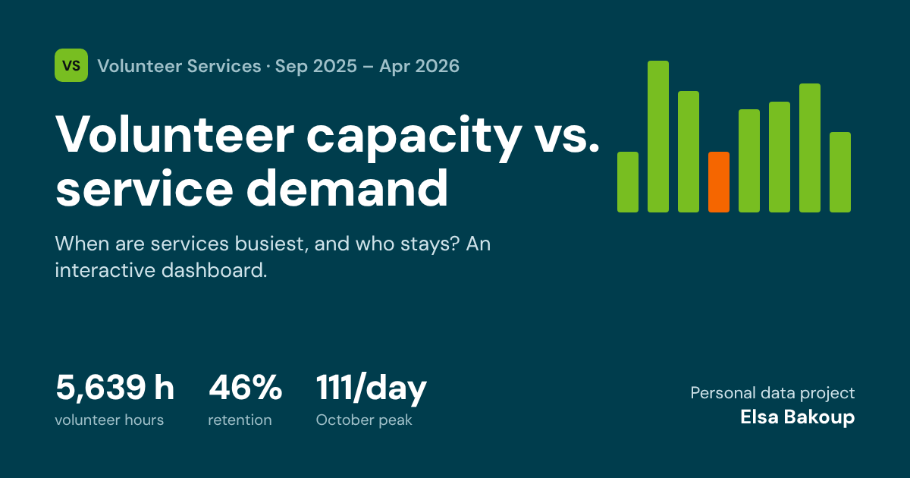

# Volunteer Services Dashboard
 
**Live dashboard: [elsa-bakoup.github.io/volunteer-services-overview](https://elsa-bakoup.github.io/volunteer-services-overview/)**
 

 
An interactive dashboard that analyses one year of Volunteer Services data (September 2025 to April 2026) to answer one question:
 
> **How can Volunteer Services align volunteer capacity with peak service demand?**
 
This is a personal initiative. As Volunteer Administration Coordinator at the University of Calgary Students' Union, I wanted to know when our programs are busiest, and to turn our own spreadsheets into staffing decisions.
 
## Key findings
 
- **Demand follows the academic calendar.** Q Center visits peak in October (111 per day) and March (94), and drop to 44 per day in December.
- **Midday is the busiest time.** Q Center traffic peaks between 12 and 1 PM, and Monday is the busiest day at both the Q Center and the VS Office.
- **Food Bank needs shift over the year.** Food hamper distribution rose into February while power packs dropped sharply after December.
- **Lost and found improved.** The share of people who got their item back rose from 23% in September to 36% in April.
- **Retention is uneven.** 46% of 2025–26 volunteers returned overall, from 60% at the Q Center to 20% in the Administrative Volunteer Program.
**Recommendation:** add midday shifts in October and March, recruit before those peaks, and track volunteer hours by month to check whether staffing follows demand.
 
## What's in the dashboard
 
| Tab | What it shows |
|---|---|
| **Overview** | Headline KPIs, demand over time, hours by program, key findings and the recommendation |
| **Demand** | Visits by hour and weekday, each month compared with the yearly average, Food Bank distribution, hygiene products and lost-item return rate |
| **Volunteers** | Retention by program, volunteers by program, and average hours for new vs. returning volunteers |
| **About** | Method, data sources, cleaning steps, program names and limitations |
 
Every chart is interactive: hover for exact values, click a month or a program to filter the whole page, and switch to dark mode. Each tab fits on one screen.
 
## Data
 
Five sources from Volunteer Services, covering September 2025 to April 2026:
 
- **Volunteer list:** program, hours contributed, new or returning, status
- **Retention tracker:** which 2025–26 volunteers returned for 2026–27 (132 volunteers)
- **Campus Food Bank:** hampers, power packs and people fed, by month
- **Information Center Lost and Found:** lost items, campus directions and hygiene products, by week
- **Foot traffic:** VS Office by day, Q Center by hour
The raw data is not included in this repository.
 
### Programs
 
| Acronym | Program |
|---|---|
| AVP | Administrative Volunteer Program |
| CFB | Campus Food Bank |
| ICLF | Information Center Lost and Found |
| Q Center | Centre for Sexual and Gender Diversity |
| VTP, SSP, RSP | Volunteer Tax Program, Student Support Program, Refugee Students Program (not included in this analysis) |
 
## Method
 
1. **Explore** the raw workbook in Excel.
2. **Clean** the data in SQL:
   - fixed ICLF dates, where some were stored as text and others had day and month swapped
   - removed a totals row that doubled every ICLF sum
   - filtered ICLF to the same September–April window as the other sources
   - fixed typos, stray spaces and inconsistent program names (VAP → AVP, Q Centre → Q Center)
   - dropped a duplicate sheet, and checked one missing value and a 175-hour outlier
3. **Analyse** with SQL aggregates and Power BI measures. Every KPI was checked in both.
4. **Present** in Power BI first, then as this interactive web version.
Monthly comparisons use daily or weekly averages rather than totals, because months had different numbers of recorded days and weeks.
 
## Limitations
 
- Volunteer hours are season totals, so staffing can't be matched to demand month by month.
- Retention covers one year only.
- Q Center early (9 AM) and late (2–5 PM) slots were recorded on about 100 of 147 days.
- The VS Office has one recorded day in September, and Food Bank "people fed" data only covers September to December.
- Counts differ by source: 132 volunteers in the retention tracker, 124 with recorded hours.
- The Volunteer Tax Program, Student Support Program and Refugee Students Program are not included.
## Built with
 
Excel · SQL · Power BI · HTML, CSS and JavaScript (no chart libraries)
 
## Files
 
| File | Purpose |
|---|---|
| `index.html` | The full dashboard: data, charts and styles in one file |
| `og-image.png` | Preview image shown when the link is shared |
 
## Author
 
**Elsa Bakoup**, data science student and Volunteer Administration Coordinator, University of Calgary Students' Union
 
[LinkedIn](https://www.linkedin.com/in/elsabakoup) · elsabakoup1@gmail.com
 
*This is a personal project, not an official Students' Union publication.*
 
